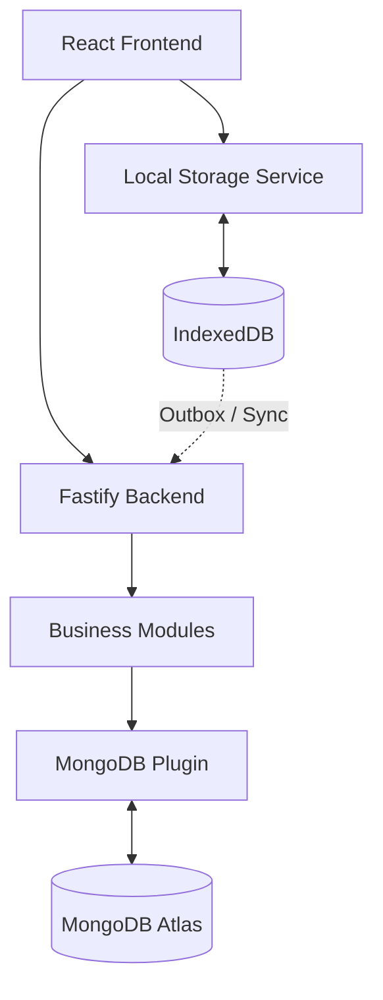
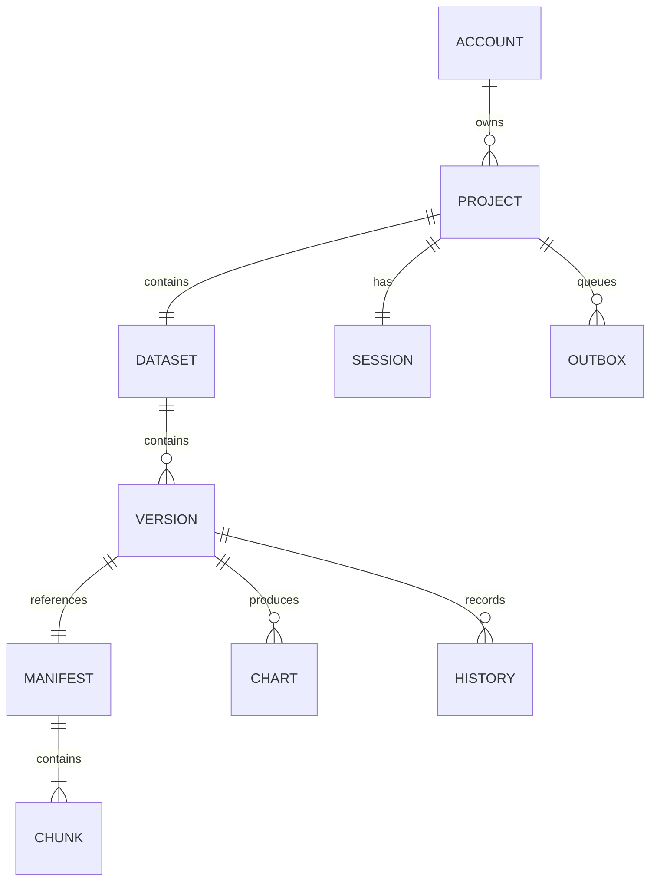
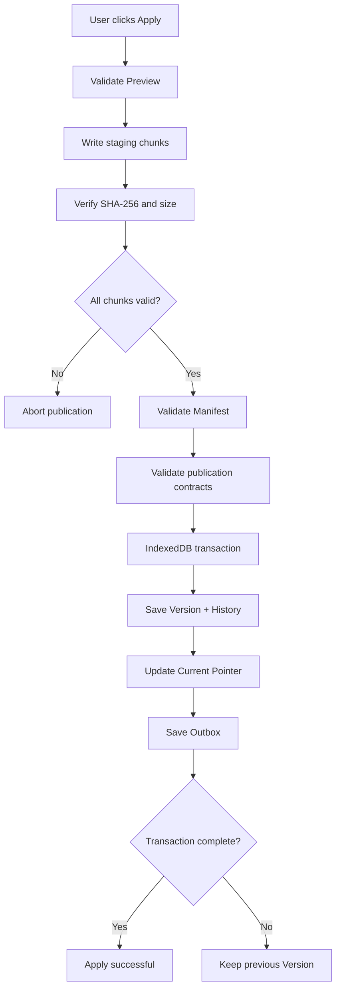

# Thiết kế kiến trúc Database

## 1. Mục tiêu và phạm vi

Tài liệu mô tả kiến trúc lưu trữ dữ liệu của hệ thống, bao gồm:

- MongoDB Atlas: lưu trữ dữ liệu phía Backend.
- IndexedDB: lưu trữ dữ liệu phía trình duyệt.
- Cơ chế quản lý Project, Dataset, Version, Session và Chart.
- Cơ chế chia dữ liệu thành Chunk và quản lý Manifest.
- Cơ chế lưu dữ liệu nhất quán (Atomic Publication).
- Cơ chế phục hồi dữ liệu (Recovery).
- Cơ chế lưu hàng đợi đồng bộ (Outbox).

### 1.1. Nguyên tắc thiết kế

1. MongoDB và IndexedDB là hai hệ thống lưu trữ độc lập.
2. Frontend không được truy cập MongoDB trực tiếp.
3. Backend sử dụng MongoDB thông qua các module nghiệp vụ.
4. IndexedDB chịu trách nhiệm lưu dữ liệu local và phục hồi phiên làm việc.
5. Dữ liệu lớn phải được chia thành nhiều Chunk.
6. Mọi thực thể sử dụng ID ổn định, không phụ thuộc vị trí phần tử trong mảng.
7. Không công bố Version mới nếu dữ liệu chưa được ghi và kiểm tra hoàn chỉnh.
8. Không xóa dữ liệu local chưa được đồng bộ thành công.

## 2. Kiến trúc tổng quan



### 2.1. Trách nhiệm từng thành phần

| Thành phần | Trách nhiệm |
|---|---|
| React | Hiển thị dữ liệu và nhận thao tác người dùng |
| Storage Service | Cung cấp API lưu, đọc, Apply và Recovery |
| IndexedDB | Lưu dữ liệu local |
| Fastify | Tiếp nhận và xử lý API |
| MongoDB Plugin | Quản lý kết nối MongoDB |
| Business Modules | Quản lý dữ liệu theo nghiệp vụ |
| MongoDB Atlas | Lưu dữ liệu phía server |

### 2.2. Quy tắc phân quyền sở hữu module

- Phúc sở hữu module `auth`, `users`.
- Tuấn sở hữu `projects`, `datasets`, `versions`, `sessions`, `charts`, `sync`.
- Trâm phụ trách database configuration, MongoDB plugin và IndexedDB storage.
- Trâm không tạo repository truy cập collection song song với các module nghiệp vụ của Phúc và Tuấn.

## 3. Thiết kế dữ liệu

### 3.1. Các thực thể chính

| Thực thể | Primary ID | Mô tả |
|---|---|---|
| Account | `accountId` | Tài khoản người dùng |
| Project | `projectId` | Dự án của người dùng |
| Dataset | `datasetId` | Bộ dữ liệu nguồn |
| Version | `versionId` | Phiên bản dữ liệu |
| Manifest | `manifestId` | Danh sách Chunk của một phiên bản |
| Chunk | `chunkId` | Một phần nội dung dữ liệu |
| Session | `sessionId` | Phiên làm việc |
| Chart | `chartId` | Cấu hình và kết quả biểu đồ |
| History | `operationId` | Lịch sử thao tác |
| Outbox | `operationId` | Thao tác chờ đồng bộ |

### 3.2. Quan hệ giữa các thực thể



Các quan hệ trên thể hiện mô hình logic. Khi triển khai MongoDB hoặc IndexedDB, quan hệ được thể hiện bằng ID tham chiếu.

**Ràng buộc nghiệp vụ:**

- Một Account có nhiều Project.
- Một Project có đúng một Dataset nguồn.
- Một Project có đúng một Session làm việc có thể tiếp tục.
- Một Dataset có nhiều Version.
- Mỗi Version tham chiếu một Manifest.
- Một Manifest chứa nhiều Chunk.
- Chart phải tham chiếu đúng Version tạo ra nó.
- History ghi nhận quan hệ giữa Version trước và Version sau.

### 3.3. Dataset và dữ liệu dạng bảng

Sử dụng contracts hiện có:

- `Dataset`
- `Row`
- `Column`
- `Cell`

Ví dụ:

```json
{
  "versionId": "version-001",
  "columns": [
    {
      "id": "col-001",
      "name": "Age",
      "type": "number"
    },
    {
      "id": "col-002",
      "name": "Gender",
      "type": "text"
    }
  ],
  "rows": [
    {
      "id": "row-001",
      "cells": {
        "col-001": 20,
        "col-002": "Male"
      }
    }
  ]
}
```

Quy tắc:

- `rowId` xác định duy nhất một dòng.
- `columnId` xác định duy nhất một cột.
- Cell được ánh xạ theo `columnId`.
- Không dùng index của dòng hoặc cột làm ID.
- Giá trị Cell tuân theo `cellSchema` trong contracts.

## 4. Thiết kế MongoDB Atlas

### 4.1. Collections

| Collection | Nội dung | Module sở hữu |
|---|---|---|
| `accounts` | Thông tin tài khoản | Phúc |
| `projects` | Thông tin Project | Tuấn |
| `datasets` | Metadata Dataset | Tuấn |
| `versions` | Metadata Version | Tuấn |
| `manifests` | Danh sách Chunk | Tuấn |
| `chunks` | Nội dung Chunk | Tuấn |
| `sessions` | Trạng thái Session | Tuấn |
| `charts` | Cấu hình và kết quả Chart | Tuấn |
| `histories` | Lịch sử thao tác | Tuấn |
| `outbox` | Trạng thái đồng bộ phía server | Tuấn |

### 4.2. Nguyên tắc lưu dữ liệu

**Metadata và Data Content được lưu riêng biệt.**

Metadata gồm:
- ID.
- Tên.
- Quan hệ giữa các thực thể.
- Trạng thái.
- Thời gian tạo/cập nhật nếu cần.
- Thông tin phiên bản và Manifest.

Data Content gồm:
- Nội dung các dòng dữ liệu.
- Nội dung Chunk.
- Dữ liệu biểu đồ nếu cần lưu kết quả lớn.

Không lưu toàn bộ Dataset lớn trong một MongoDB document vì MongoDB có giới hạn kích thước document 16 MiB.

Ưu tiên thiết kế Chunk riêng hoặc GridFS khi phù hợp.

### 4.3. Index đề xuất

| Collection | Index | Mục đích |
|---|---|---|
| accounts | `usernameNormalized` UNIQUE | Không trùng username |
| projects | `ownerId` | Truy vấn Project theo chủ sở hữu |
| datasets | `projectId` UNIQUE | Một Dataset nguồn mỗi Project |
| versions | `datasetId` | Truy vấn Version |
| versions | `projectId, datasetId` | Truy vấn theo Project và Dataset |
| chunks | `manifestId, ordinal` UNIQUE | Xác định thứ tự Chunk |
| sessions | `projectId` UNIQUE | Một Session mỗi Project |
| charts | `versionId` | Truy vấn Chart theo Version |
| histories | `operationId` UNIQUE | Chống trùng thao tác |
| outbox | `accountId, operationId` UNIQUE | Chống xử lý đồng bộ trùng |

Lưu ý: Index và unique constraint cần được thống nhất với các module sở hữu collection trước khi triển khai.

### 4.4. MongoDB Connection

Backend sử dụng:

- Node.js.
- Fastify.
- MongoDB Node.js Driver.
- Environment variables.

Cấu hình:

```env
MONGODB_URI=<your-mongodb-connection-string>
MONGODB_DATABASE=dashboard_3d
```

Quy tắc bảo mật:

- Không lưu URI thật trong Git.
- Không đưa credential vào frontend.
- Không ghi password hoặc connection string vào log.
- `.env.example` chỉ chứa placeholder.
- Kiểm tra cấu hình bằng environment validation.

## 5. Thiết kế IndexedDB

### 5.1. Database

Tên database:

`dashboard-3d`

IndexedDB là nơi lưu dữ liệu local chính của ứng dụng.

### 5.2. Object Stores

| Object Store | Primary Key | Nội dung |
|---|---|---|
| `projects` | `id` | Project và current version |
| `datasets` | `id` | Metadata Dataset |
| `versions` | `id` | Các Version |
| `manifests` | `id` | Danh sách Chunk |
| `chunks` | `id` | Nội dung Chunk |
| `sessions` | `id` | Trạng thái phiên |
| `charts` | `id` | Cấu hình và kết quả Chart |
| `histories` | `operationId` | Lịch sử thao tác |
| `outbox` | `operationId` | Hàng đợi đồng bộ |

Đây là schema IndexedDB đề xuất. Các trường metadata bổ sung phải được triển khai dưới dạng storage record wrapper, không tự ý thay đổi contracts dùng chung.

### 5.3. Cấu trúc dữ liệu tham khảo

**Project**

```typescript
interface LocalProjectRecord {
  id: string;
  ownerId: string;
  name: string;
  datasetId: string;
  sessionId: string;
  currentVersionId: string | null;
}
```

**Version**

```typescript
interface LocalVersionRecord {
  id: string;
  projectId: string;
  datasetId: string;
  parentVersionId: string | null;
  manifestId: string;
  source: 'import' | 'apply' | 'sync-conflict';
  status: 'staging' | 'committed';
}
```

**Chunk**

```typescript
interface LocalChunkRecord {
  id: string;
  manifestId: string;
  ordinal: number;
  bytes: number;
  sha256: string;
  data: ArrayBuffer;
}
```

**Manifest**

```typescript
interface LocalManifestRecord {
  id: string;
  chunks: Array<{
    id: string;
    ordinal: number;
    bytes: number;
    sha256: string;
  }>;
  totalBytes: number;
}
```

Các cấu trúc trên là ví dụ cho lớp lưu trữ local. Khi triển khai cần đối chiếu và tái sử dụng `versionSchema`, `manifestSchema` và `chunkReferenceSchema` trong contracts.

### 5.4. Index IndexedDB đề xuất

| Object Store | Index |
|---|---|
| projects | `ownerId` |
| datasets | `projectId` |
| versions | `projectId`, `datasetId` |
| manifests | `versionId` nếu lưu quan hệ ngược |
| chunks | `manifestId`, `manifestId + ordinal` |
| sessions | `projectId` |
| charts | `versionId` |
| histories | `fromVersionId`, `toVersionId` |
| outbox | `projectId`, `status` |

Các index phải phục vụ truy vấn thực tế và không tạo dư thừa.

## 6. Quy trình lưu dữ liệu nhất quán

### 6.1. Luồng Apply

Khi người dùng nhấn Apply:

1. Kiểm tra Preview còn hợp lệ.
2. Kiểm tra `baseVersionId` khớp Version hiện tại.
3. Tạo Version mới ở trạng thái staging.
4. Chia dữ liệu thành các Chunk.
5. Ghi từng Chunk vào IndexedDB.
6. Tính và kiểm tra SHA-256 từng Chunk.
7. Kiểm tra số lượng, thứ tự và tổng kích thước Chunk.
8. Kiểm tra Manifest.
9. Validate quan hệ giữa Version, Manifest, History và Outbox bằng `applyPublicationSchema`.
10. Mở một IndexedDB readwrite transaction.
11. Công bố Version, History, current version pointer và Outbox trong cùng transaction.
12. Chỉ báo lưu thành công sau khi transaction hoàn tất.

### 6.2. Sơ đồ Publication



### 6.3. Nguyên tắc Atomic Publication

Các thành phần sau phải được công bố nhất quán:

- Version mới.
- History.
- Current Version pointer.
- Outbox.

Không bắt buộc đưa toàn bộ dữ liệu lớn vào một transaction duy nhất.

Chunk được ghi trước vào staging và chỉ được tham chiếu bởi Version đã công bố sau khi xác minh thành công.

Nếu transaction công bố thất bại:

- Current Version không thay đổi.
- Không thông báo Apply thành công.
- Giữ Version trước đó.
- Các Chunk staging không còn sử dụng được dọn dẹp an toàn sau đó.

## 7. Recovery – Khôi phục dữ liệu

### 7.1. Mục tiêu

Đảm bảo người dùng có thể mở lại Project và tiếp tục từ commit hoàn chỉnh gần nhất.

### 7.2. Quy trình Recovery

1. Mở IndexedDB.
2. Đọc Project.
3. Đọc current version pointer.
4. Tìm Version tương ứng.
5. Đọc Manifest.
6. Kiểm tra các Chunk tồn tại.
7. Kiểm tra kích thước và SHA-256.
8. Ghép dữ liệu theo thứ tự ordinal.
9. Validate dữ liệu bằng contracts.
10. Khôi phục Session, History và Chart.
11. Hiển thị dữ liệu đã lưu.

### 7.3. Xử lý lỗi

| Tình huống | Hành động |
|---|---|
| Không mở được IndexedDB | Báo lỗi storage |
| Thiếu Manifest | Không khôi phục Version đó |
| Thiếu Chunk | Báo dữ liệu không đầy đủ |
| Hash không khớp | Không sử dụng Chunk |
| Current pointer không hợp lệ | Kiểm tra commit hợp lệ gần nhất |
| Hết quota | Báo lỗi và giữ commit cũ |
| Tab bị đóng đột ngột | Khôi phục commit hoàn chỉnh gần nhất |

Không dựa vào sự kiện `beforeunload` để đảm bảo lưu dữ liệu.

## 8. Outbox và đồng bộ

### 8.1. Mục đích

Outbox lưu các thao tác local đã được công bố thành công nhưng chưa được xác nhận đồng bộ với server.

### 8.2. Trạng thái

Theo `outboxSchema`:

- `pending`
- `uploading`
- `conflict`
- `auth-required`
- `retryable-error`

### 8.3. Nguyên tắc

- Outbox phải được công bố cùng ranh giới transaction với dữ liệu local tương ứng.
- Mỗi thao tác có `operationId` ổn định.
- Retry không tạo bản sao thao tác.
- Chỉ xác nhận đồng bộ sau khi server lưu và công bố đầy đủ.
- Không xóa dữ liệu local chỉ vì đồng bộ thất bại.
- Khi xung đột, bảo toàn dữ liệu local và không ghi đè âm thầm.

Phần giao tiếp API và điều phối đồng bộ thuộc module `sync` của Tuấn; Trâm chịu trách nhiệm đảm bảo cấu trúc lưu local hỗ trợ cơ chế này.

## 9. Session và Chart

### 9.1. Session

Session phải lưu:

- `projectId`
- `datasetId`
- `currentVersionId`
- Mục chức năng đang mở.
- Cấu hình đã xác nhận.
- Chart đang sử dụng.
- Camera position.
- Camera target.
- Zoom.
- Table filters.
- Table sorts.
- Selection.

Selection phải sử dụng:

- `versionId`
- `rowId`
- `columnId`

### 9.2. Chart

Chart phải tham chiếu đúng Version nguồn.

Lưu:

- Chart ID.
- Section.
- Version ID.
- Configuration.
- Result Manifest ID.
- Số dòng hiển thị.
- Tổng số dòng.

Khi mở lại Session:

- Khôi phục kết quả Chart đã lưu.
- Không tự động chạy lại thuật toán.
- Chart thuộc Version cũ chỉ được xem, không sử dụng để chỉnh sửa Version hiện tại.

## 10. Kiểm thử và tiêu chí nghiệm thu

### 10.1. Kiểm thử IndexedDB

- Tạo và mở database thành công.
- Ghi và đọc Project.
- Ghi và đọc Dataset.
- Reload trang không mất dữ liệu đã commit.
- Kiểm tra Version và Manifest.
- Kiểm tra Chunk và checksum.

### 10.2. Kiểm thử Publication

- Apply thành công.
- Ghi Chunk thất bại.
- Manifest không hợp lệ.
- Hash không khớp.
- Transaction bị abort.
- Outbox không bị thiếu.
- Current pointer không bị thay đổi khi thất bại.

### 10.3. Kiểm thử Recovery

- Mở lại Project sau reload.
- Khôi phục Version gần nhất.
- Phát hiện Chunk bị thiếu.
- Phát hiện Chunk sai checksum.
- Khôi phục Session và Chart.
- Không phục hồi Preview chưa Apply.

### 10.4. Kiểm thử MongoDB

- Kết nối database.
- Environment validation.
- Unique index.
- Kiểm tra ownership.
- Xử lý lỗi kết nối.
- Đóng kết nối khi Backend shutdown.

### 10.5. Điều kiện hoàn thành

| Hạng mục | Tiêu chí |
|---|---|
| Database design | Có tài liệu và quan hệ ID rõ ràng |
| IndexedDB | Ghi/đọc được dữ liệu thật |
| Publication | Không công bố dữ liệu chưa hoàn chỉnh |
| Recovery | Khôi phục được commit hợp lệ |
| Session | Khôi phục đúng trạng thái đã lưu |
| Outbox | Giữ dữ liệu chưa đồng bộ |
| MongoDB | Có cấu hình và kết nối được khi được triển khai |
| Integration | API storage thống nhất với Frontend và Worker |
| Testing | Có test thành công và test lỗi |

## 11. Phạm vi triển khai và phân công

| Thành viên | Phối hợp |
|---|---|
| Trâm | Thiết kế database, MongoDB plugin, IndexedDB, Publication và Recovery |
| Phúc | Account, Authentication và username unique |
| Tuấn | Project, Dataset, Version, Session, Chart và Sync API |
| Phát | Tích hợp Storage API vào giao diện |
| Nguyên | Worker xử lý dữ liệu, cung cấp dữ liệu đầu ra cho Storage |
| Nga | Tích hợp Chart và trạng thái dữ liệu với giao diện 3D |

## 12. Tài liệu tham khảo

- `docs/teamwork/phan-cong-thanh-vien.md`
- `docs/architecture/task-01-decisions.md`
- `docs/architecture/foundation.md`
- `docs/prompt/prompt_cong_nghe_dashboard_3d.md`
- `docs/prompt/prompt_tong_quan_chuc_nang_va_tuong_tac_3d.md`
- `packages/contracts/src/index.ts`

---

**Người phụ trách:** Trâm – Database và Local Storage.

**Trạng thái tài liệu:** Đề xuất thiết kế, cần thống nhất với Phúc và Tuấn trước khi triển khai các schema và repository nghiệp vụ.